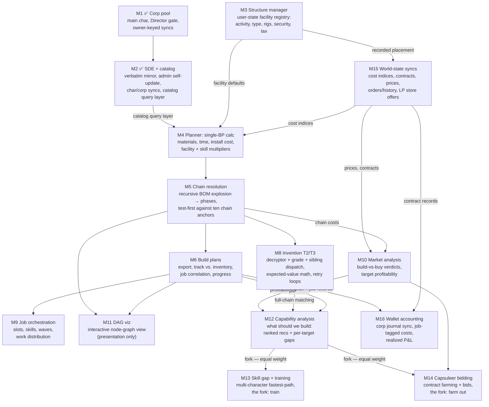

# Milestones — Industry Planner

The build-out plan for the industry planner, derived from `TODO.md` (which
stays the surface for small items and ideas). Each milestone carries its
goal, scope, and a validation step, so a session can pick one up and go.
Order matters within a track, not across all of them — dependencies are
called out explicitly.

Validation case throughout: the **Typhoon** (T1 battleship) blueprint. The
chain it produces (ship → components → reaction intermediates → moon
materials, PI (Planetary Industry) commodities, and minerals) is familiar ground and
exercises phases, blueprint availability, and asset measurement.
Correction (2026-11-16, confirmed against the live mirror): the chain
**does require reactions** (though not invention) — the components take
reaction products (Pressurized Oxidizers, Reinforced Carbon Fiber)
whose own recipes are a further reaction layer consuming fuel blocks
(manufacturing) and moon materials. Reactions commonly sit in the
early, deep portions of even T1 chains, which is why reaction
resolution is part of M5's initial scope rather than a later
extension. Invention arrives only with T2 targets; T3's interface
with it is to-be-determined (M8).

## End goal (clarified 2026-11-16)

A **work-distribution planner** for a single corporation and its
registered characters, building target products as efficiently as
possible — reduced material inputs with maximum time efficiency.

Input a target build and quantity; the system reverses the product
chain to raw-material inputs, then builds up every chain layer,
distributing the work across the corporation's characters based on
skill availability for each blueprint and chunking it across available
build slots so the components the next stage needs complete as fast as
possible. The parallelism mechanism is **BPC (Blueprint Copy) copies**:
the planner recommends how many copies to make from owned BPOs
(Blueprint Originals) and each one's run
count, so jobs install simultaneously across slots — a single
max-run job is always the most material-efficient but slowest, so
more slots are bought at a material cost. A **profit-vs-throughput
control** (plan-level, **three positions**, 2026-11-18) sets the
plan's posture: **profit** concentrates work on the builders and job
splits whose skills and run counts reduce input-material requirements
(most profit per build, everything in-corp); **balanced** farms chain
portions out to friends at below-market rates — the same wall-time
win as purchasing at lower cost; **throughput** purchases whatever
shortens wall time and fills every available slot to produce as many
final targets as possible in the shortest time.

The system closes the loop on the roster itself. Capability analysis
matches the corp's synced skills and owned blueprints against the
buildable catalog — recommending end products the corporation is
positioned to produce, and identifying per-target gaps (missing
skills, missing blueprints). Those gaps have three responses, which
is where the roadmap forks (equal-weight alternatives, owner's call
at pickup): **train** (per-character skill plans toward a target's
maximum efficiency), **farm out** (bid chain portions to friends as
paid contracts), or **pick a better target**.

---

## Status (updated 2026-11-22)

| Milestone | State |
|---|---|
| M1 — main character & corporation pool | ✅ **Complete** (PRs #12–#14) |
| M2 — SDE foundation & blueprint catalog | ✅ **Complete** (PRs #15–#17 + #85, 2026-11-22/23) |
| Mockup program | ✅ **Complete — 13 of 13** (2026-11-22): ten chain sets (Typhoon → Ragnarok) + the refinement pass + three surfaces (structures M3, markets M15, capability M12); the 2026-11-22 conventions (facilities/markets selection, market panels, wave paging, Ƶ, static scaffolding, variable-content marking) cover every page |
| M3+ | Not started (implementation) |

**Pick up at**: **M3 structure manager** — fully designed (revised
schema sketch + landed surface mockup), independent of the catalog, and
carries the nav change; it lands alongside the **M4 planner's** start
(the calculator that consumes M2's catalog query layer). Per the order
of operations below, M15's framework slice + The Forge seed start right
after M3 so the sync band soaks while M4/M5/M6 build.

**Order of operations** (refined 2026-11-22, final pre-implementation
evaluation): the spine holds (M2 → M4 → M5 → M6 → M9) with three
refinements the completed design program makes possible:

- **M3 lands immediately after (or alongside) M2**: it is
  independent (user-state registry, no catalog dependency), fully
  designed through the revised schema, small, and carries the nav
  change — removing a dependency from M4's critical path.
- **M15 starts early and soaks deliberately**: kick off the
  framework slice + The Forge seed right after M3, so the sync band
  accumulates rate-limit history and freshness data *while M4/M5/M6
  are built* — cost indices, contract fallbacks, and prices arrive
  soaked, and the headroom gate has real expansion history. The
  remaining families land alongside their consumers per the
  recorded deferral.
- **M8 parallels M6/M9** (off M5); **M11 free-floating** after
  M5/M6; **M10 after M15's soak**; **M12 the fork point**; the
  M13/M14 choice stays with the product owner at pickup; **M16
  late**.
The 2026-11-22 TODO fold-in dissolved the planner-track TODO
sections into their owning milestones (M6 carries the triaged
five-item scope; the skill planner generalization moved to M13);
TODO.md now holds the platform track and smaller items.

**The mockup program's output** (2026-11-19 → 2026-11-21): ten chain
reference documents (`reference/chains/`, Typhoon through Ragnarok)
serving as M5's acceptance suite; ten mockup sets (`design/`)
carrying the binding UI conventions; the whole-catalog census
(`reference/CENSUS.md` — phase depth bounded at 7, 51 producer-graph
cycles making M5's defensive cycle detection provably necessary); and
the faction-commodity investigation (TODO.md — LP store offer catalog,
loyalty scope registered and live-verified, corp-LP modeling). The
chain program deposited design decisions across M5/M6/M8/M9 (retry
semantics, copy sizing and destinations, merged-campaign arithmetic,
commodity-first targeting, the participants section, residue
accounting) — each recorded in MILESTONES' decisions and open
questions below, with the chain docs as their proof.

Live anchors for a fresh session: schlepzrage is the main (Director,
corp 98830898, all corp data synced); SDE release 2026-11-20 mirrored
(53,925+ types) and self-maintaining. All eight characters sync
blueprints, skills, jobs, and **loyalty points** (the
`esi-characters.read_loyalty.v1` scope registered 2026-11-21 and
re-authed roster-wide; the contracts read scopes are also registered).
The chain reference library reads end to end through the mirror
(Typhoon 998→644 through Ragnarok 23774→23773), so the catalog's
recipe joins have ten validated shapes to test against, not one.
Two things worth knowing before the catalog work: the skills table
carries **trained vs active** level separately (active includes
implants/boosters — M4's time math should pick deliberately), and
`UniverseResolver.resolve_location_ids` is the ready-made primitive
for naming any location id that arrives without a type (the M6 jobs
correlation and any future Location column want it).

### Dependency graph (milestone level)

Arrows read "is a dependency of" — the arrow's target needs the
source. The mockup gate (the 2026-11-19 convention) completed
2026-11-22 at 13 of 13 sets — ten chain sets plus the structures,
markets, and capability surfaces — and is dropped from the graph;
the implementation track below is cleared to run.

Notes on the graph:

- **The spine** (recorded critical path, 2026-11-19 review): M2
  catalog → M4 → M5 → M6 → M9. M8 branches off M5 (the invention
  resolver extends the chain resolver; it can land in parallel with
  M6/M9). M11 is presentation-only and sequenced freely after M5/M6.
- **M15's position** (recorded 2026-11-19): after M3, as one cohesive
  sync band; consumption is deferred to each consuming milestone and
  the pre-consumer gap is a deliberate soak test. Cost indices feed
  M4's install-cost math; market data feeds M10; contracts feed M6's
  fallbacks and M12's capability matching; LP store offers feed the
  faction acquisition layer (M6).
- **The fork** (M13/M14): deliberately unsequenced against each
  other — the product owner decides at pickup. M10 is a dependency
  of M14 only (bidding needs prices); M13 has no M10 dependency
  (skill analysis is price-free).
- **M16** (added 2026-11-22): a late milestone near the end of the
  program, after the fork — wallet journal sync plus the
  job-association layer turning entries into realized costs and
  returns per plan. Depends on M6 (the plans and job records
  entries associate against) and M15 (contract records).
- **M7** is absent — folded into M5 (2026-11-16).

---

## Architecture: three data layers

Every planner feature is a join across exactly these layers. Keeping the
split crisp is what lets T2/T3 and reactions arrive later as *data and
resolver extensions* instead of schema rewrites.

| Layer | Source | Nature | Examples |
|---|---|---|---|
| **Static (recipes)** | EVE SDE, imported | Write-once per EVE release | blueprint → materials, products, required skills, activity durations, invention probabilities |
| **Dynamic (world state)** | ESI (EVE Swagger Interface), ETag-cached sync | Refreshed in background | owned blueprints (ME (Material Efficiency)/TE (Time Efficiency)/runs), skills, industry jobs, assets, cost indices, public contracts, market prices & regional orders/history (M15) |
| **User state** | This app | User-managed CRUD | main character, structures, build plans, job assignments |

Two consequences worth stating outright:

- **ESI cannot answer "what does this blueprint build from."** The
  production chain lives in the SDE (`industryBlueprints` as the
  registry, `industryActivityMaterials`, `industryActivityProducts`,
  `industryActivitySkills`). ESI supplies what the SDE can't: which
  blueprints you own, who you are (skills), what's installed (jobs),
  where things sit (assets), and what it costs (indices, later prices).
- **The schema models all industry activities from day one** —
  manufacturing, copying, invention, reactions, and T3 reverse
  engineering — via a generic activity dimension. V1 *resolves* the
  T1 manufacturing + reaction chain (reactions included per the
  revised v1-scope decision); invention/T2 and T3 land incrementally
  without migrations that retrofit activity types.

### Decisions already made

- **SDE source**: managed import command — downloads the fuzzwork SQLite
  dump for the current EVE release and mirrors it verbatim (see M2's
  landed-as notes). Re-run per release; nothing checked into git.
  Landed 2026-11-16 with the admin self-update.
- **V1 chain scope** (revised 2026-11-16): T1 manufacturing **and
  reactions** — even the Typhoon validation chain carries two reaction
  layers, so reactions resolve with the initial chain (M5) rather than
  as a later extension; invention/T2 and T3 follow. Schema supports
  all from the start.
- **Market pricing**: deferred (separate milestone, near the end). The
  planner computes materials, time, and install cost from tax + system
  cost index; build-vs-buy and profitability come with the market
  pipeline.
- **Visualization**: phase-grouped expandable views first (reusing the
  assets-page collapsible-row patterns); interactive node-graph DAG is
  its own follow-up milestone.
- **Reference implementation** (2026-11-17): proof-out scripts in
  `reference/` — chain expansion (M5), the time-balanced
  scheduling/timeline model with per-character skill multipliers
  (M4/M9), and BPO obtainment recommendations (M12) — regenerate
  `reference/chains/TYPHOON-CHAIN.md`'s golden values and are the executable spec the
  milestones graduate into the app. See `reference/README.md` for the
  formula reference and flagged assumptions.
- **Stage-state model** (2026-11-18, from the mockup iteration —
  `design/typhoon/` is the visual spec): five node states — Missing
  inputs, Ready to build, In progress, Ready to deliver, Stage complete
  ("In progress" fills the spec's gap between Ready to build and Ready
  to deliver) — carried by the state chip, with the gating reason (BPC
  copy progress, a waiting upstream phase) as secondary text + meter
  beside the chip. Phase summaries roll up from children (worst child
  wins); nodes marked Purchase drop out of the phase state and percent
  and count toward the acquisition side instead. Purchase ⇄ Build is
  node-level in the data model (purchase decisions are per-commodity)
  with a phase-level bulk toggle recovering stage-level ergonomics.
  Pre-calculation purchase intent is deliberately rejected
  (2026-11-18): the marking flow lives on the calculated plan — the
  same node-marking mechanism M14's farming reuses — so
  calculation-time inputs stay minimal.
  (M5/M6.)
- **Next-up assignment** (2026-11-18): each queued job is assigned to
  exactly one character — the spec's definite "the next job that should
  be executed in this slot" — and slot queues show the next job plus at
  most one "then", with a "+N more" count when the backlog runs deeper.
  (M9.)
- **Blueprint availability is plan-time** (2026-11-18): required-
  blueprint status (Missing / Owned) renders at build-plan time only;
  once a plan is active the blueprint set is considered immutable, so
  the active view omits the section. Purchasing removes the node's
  inputs from the raw-material math — the commodity itself is what
  gets acquired. **Missing-blueprint default (refined 2026-11-18,
  from the Charon chain)**: acquire BPCs off contract and backfill
  what the plan requires — owning a BPO for every component fails
  economy-of-scale (a fully-researched BPO costs isk; an unresearched
  one costs isk plus research time; BPCs cost far less but must be
  costed and availability-checked per plan, which needs contract /
  market data). Buying the commodity outright remains the alternative;
  BPC vs commodity vs BPO is an economy-of-scale call the isk math
  (M10) and the BPO-recommendation ladder (M12) inform. **Contract
  matching (2026-11-18)**: the availability check matches contracts
  whose contents are exactly the wanted item — a contract that merely
  includes the Charon BPC among other items is not a match, so the
  plan never prices unwanted bundled items. Whether same-type
  multiples (several identical BPCs in one contract) qualify is an
  implementation-time call. **Scan scope (2026-11-19, refined)**:
  contract searches default to the standard NPC trade-hub regions
  (The Forge, Domain, Heimatar, Metropolis, Sinq Laison) — where BPC
  contracts actually list. (The rollout is staged — The Forge first —
  per the market-data region policy.) Region stays display metadata on results,
  never a filter. ESI's public-contracts endpoint is per-region by
  construction and has **no item-level search** (the listing carries
  no contents), so candidates pre-filter on contract type
  `item_exchange` plus a tight volume band (a BPC contract is ~0.1
  m³) before the per-contract items call. **No price filtering** —
  below-market BPCs are finds, not noise. An all-region sweep
  remains possible but is not the default. **BPC selection
  bias (2026-11-18)**: when
  several contracts satisfy a missing blueprint, the
  profit-vs-throughput slider picks which — profit biases toward the
  highest ME (cost), throughput toward the highest TE (wall time),
  balanced toward the best combination (max on both ideally, else
  the highest average). Verified against live ESI: the public
  contract-items response carries `is_blueprint_copy`,
  `material_efficiency`, `time_efficiency`, and `runs` per BPC, so
  the bias needs no data source beyond the contracts sync.
  **Three acquisition paths, not two (2026-11-19, from the Panther
  chain)**: invented (T2 ship/module BPCs — the invention layer),
  contracted (BPCs off the public-contract market), and **NPC-seeded
  market originals** (T2 component BPOs have no producer in the SDE —
  they are cheap NPC-sold originals, so the contract-backfill default
  does not apply to them; the planner buys them on the market like
  any commodity). (M5/M6/M12; the sync itself is M15.)
- **World-state syncs land as one band** (2026-11-19; LP store
  offers added 2026-11-21): the remaining public-data sync
  families — cost indices, public contracts, global market prices,
  regional orders/history, **LP store offers** (the fuzzwork
  lpstore dataset: lpOffers + lpOfferRequirements CSVs / JSON API,
  31,952 offers across 181 store corporations, keyed by
  `corporation_id` — the join key the loyalty balances already
  carry; surfaced by the faction-commodity investigation) —
  implement together in M15
  as one cohesive set of functions and schema, rather than piecemeal
  across the milestones that consume them: one converged sync
  workflow, not the same pattern re-implemented per milestone. The
  framework decisions (a public-endpoint sync category with no scopes
  or role gates, per-family cadence and pruning, a shared rate-limit
  budget, one status view) are made deliberately once; schemas
  verbatim-mirror their payloads per the SDE lesson, so data lands
  statically and interpretation stays with the consuming query layer.
  Implementation does not imply consumption — each milestone reads
  the data when its surfaces need it, and the gap is a deliberate
  soak test: sync observability (status, rate limits, staleness) is
  pulled forward from the platform track to land with the band, and
  cadence/API-access tuning happens against real-world sync runs.
  Regional orders/history initially stayed with M10 (the parked
  region-choice question) and folded into the band the same day the
  market-data region policy resolved it — as the heaviest slice, with
  a staged rollout (The Forge alone first) so the soak test measures
  one region's headroom before coverage grows. Player-structure
  markets (the Amamake home structure's market module) ride along as
  the band's one character-scoped source, gated per the landed
  per-kind pattern. The landed character/corp syncs are not
  retrofitted onto the generalized framework. (M3/M10/M15.)
- **Market-data region policy** (2026-11-19): regional market data
  (orders, history, public contracts) syncs a user-managed hub set —
  the target default is the five NPC trade-hub regions (The Forge,
  Domain, Heimatar, Metropolis, Sinq Laison), one region-set concept
  across the world-state band, sharing its rate-limit budget. **The
  rollout is staged: the hub set starts with The Forge alone** —
  measure one region's rate-limit headroom before expanding
  coverage; a single region may already brush the limits. The set is
  **user-extensible in two directions**: additional public regions
  (custom region hubs, e.g. null-bloc markets), and
  **player-structure markets the roster can access** — the
  motivating case is the corp's own Amamake structure (5 Times Nearly
  Winners) with a market module. Structure markets sync through the
  character-scoped `/markets/structures/{structure_id}/` (a scoped
  sync kind riding the landed scope-gating pattern, not the public
  category); public contracts listed at that structure already arrive
  via the Metropolis region scan. Price lookups default to The Forge
  (Jita, the liquidity reference; M14's bid pricing already assumes
  it) with a plan-time selector among synced hubs — the corp builds
  and delivers in Amamake (Metropolis), so Jita-vs-local is a real
  per-plan choice. System-level hubs inside a synced region (Amamake
  itself) are a query-layer filter over that region's orders (the
  endpoint carries `system_id`), never extra sync scope. Full daily
  history is retained (append-only, one row per type per region per
  day); windowing is a query-layer concern, never a sync-shape
  decision. Region stays selection metadata on planner results, never
  a sync-scope change; an all-region sweep remains possible but is
  not the default. (M10/M15.)
- **Skill gate (2026-11-19)**: build planning checks each blueprint
  for usability as well as availability — at least one character in
  the pool holding the activity's required skills
  (`sde_activity_skills`: manufacture, react, invent). A blueprint
  with no skilled character forces its node to the purchase path
  (market or farming) regardless of BPC availability, and contract
  searches for it are skipped as unnecessary. The calculated plan
  marks these nodes distinctly — skill-gated, not blueprint-gated —
  so the acquisition story explains why purchase is forced.
  (M4/M5/M9; eligibility was already M9's assignment input — this
  makes it a plan-time gate. Live check 2026-11-19: the roster passes
  the Charon chain — Octavia holds Capital Ship Construction.)
  **Waves and job alignment respect the same eligibility (2026-11-19)**:
  a wave's install requests only go to characters holding the job's
  required skills, and single-holder skills serialize that work onto
  one character regardless of free slots — the wave view makes the
  bottleneck visible (e.g. every Capital-Ship-Construction job in a
  Charon plan lands on Octavia alone). **Plan calculations weight
  durations by assignee (2026-11-19)**: job alignment feeds the time
  model — each job's duration uses its assigned character's skill
  multiplier, so who runs what changes the chain-end estimate. The
  scheduler assigns eligibility-first, then optimizes: the
  throughput end puts jobs on the fastest eligible characters, the
  efficiency end runs the skill-weighted distribution; single-holder
  skills serialize both the jobs and the multiplier. The reference
  model's single-multiplier runs remain scenarios, not the app's
  behavior.
- **Planner requirement overview** (2026-11-19): pre-calculation shows
  the full per-unit chain in three collapsible tiers — blueprints
  (owned/missing status with a contract-backfill peek on missing),
  intermediates (grouped by phase, per-unit quantities), raw
  terminators (by category, with coverage standouts) — quantities
  tracking the target stepper live. Calculate schedules (phases,
  waves, allocation, copy plan); the chain itself resolves at
  selection. Direct-inputs-only was rejected: it is
  recipe-dependent-inconsistent (the Typhoon takes minerals directly,
  the Charon takes none). The tier list is open-ended — invention
  inputs join as their own tier when M8 chains arrive, kept simple at
  the overview level: the source-BPC → invented-BPC relationship
  (Typhoon BPC → Panther BPC) and nothing more. The rich invention
  math — decryptor selection, success rate per decryptor, decryptor
  inventory vs purchase — lands on the calculated plan (M8 pickup).
  (M4.)
- **Phase numbering** (2026-11-18): phases count up in build order —
  raw-material terminators at phase 0, a node's phase = 1 + max(its
  inputs' phases), target at the highest number — so phase and wave
  numbers both increase toward completion (waves are temporal install
  batches, phases are dependency layers; progress moves both counters
  the same direction). The mockups, the reference scripts, and
  `reference/chains/TYPHOON-CHAIN.md` all use the ascending
  convention (the reference renumber landed 2026-11-18 alongside the
  first new chain document). (M5.)
- **Copy-vs-direct presentation** (2026-11-18): the planner applies the
  copy-vs-direct rule (`reference/chains/TYPHOON-CHAIN.md`) in its
  wave composition but does not surface the calculation as dedicated
  UI — the wave job
  requests are the surface: an early wave requests the blueprint copies
  later phases need, and a later wave's job request simply uses the BPO
  directly where a copy was unnecessary. (M9.)
- **Purchase-vs-copy crossover** (2026-11-18, from the ×10 simulation):
  purchasing a node (or phase) wins on wall time whenever procurement
  lead time < the node's copy-queue overflow + build time. For the
  Typhoon chain the AIPS (Auto-Integrity Preservation Seal) copy
  queue ÷ reaction dead zone = 1.56 at
  every target count, so the copy pipeline is the constraint at any N
  — there is no scale at which copying catches up, and purchasing
  phase 4 collapses phases 1–3 out of the math entirely (their
  outputs lose their only consumers). The time side is closed-form;
  whether to pay is the slider's job (the isk side needs M10). The
  waves carry the outcome — no dedicated UI, per the copy-vs-direct
  presentation decision above.
- **Invention is a parallel branch, not a phase** (2026-11-19, from
  the Panther chain): the invented BPC gates only the final build
  node, so attempts install in wave 1 alongside the deepest-phase
  jobs (the wave-membership rule already allows this — waves mix
  phases and activities). Attempts batch across BPCs per the
  blueprint job-lock: wall time is one invention-duration window per
  batch with confidence by batch size (10 BPCs → 92% at the Panther's
  22%), trading datacores for wall time the same way copy-vs-direct
  trades material efficiency. A **fixed decryptor per plan** keeps
  material quantities deterministic while invention is in flight —
  deferring the choice would shift the bill ≈1% per ME point with the
  outcome (an argument for the fixed-choice side of the M8
  fixed-vs-EV question). The practical gate is datacore acquisition,
  not scheduling. Worked numbers: `reference/chains/PANTHER-CHAIN.md`'s
  parallel-invention-branch section. (M8/M9.)
- **Corp access and material distribution** (2026-11-19, from the
  Panther mockup work): jobs install from hangars the installer can
  access — corp-affiliation is a real eligibility dimension alongside
  skills and slots. Plan participation defaults to the corp's members;
  out-of-corp roster characters join only when explicitly included
  (a per-plan "request access" choice), and their jobs need a
  **distribution step** — an in-game contract or station trade moving
  the materials and blueprints to somewhere they can install from —
  which is itself a plan item with procurement lead, informed by M15's
  contract/market data. Live grounding: blitzrage, the roster's only
  invention-skill holder, is out-of-corp (1413715023 vs the main's
  98830898) — every invented-blueprint plan routes its critical jobs
  through an out-of-corp character. (M4/M9.)
- **Unresolvable paths force an acquisition fallback** (2026-11-19):
  extends the skill gate — when the participant pool cannot cover an
  activity (e.g. no inventor for the target blueprint's invention),
  that acquisition path is unresolvable in-plan and falls back to
  contract/market purchase, surfaced **distinctly from
  blueprint-missing** (the gating reason reads "no eligible
  character," not "no blueprint") with remediation actions: include
  the out-of-corp skill holder (adding the distribution step) or
  purchase instead. (M4/M5.)
- **Slider is three positions, not a continuous bias** (2026-11-18):
  **profit** (left — build in-corp at maximum efficiency), **balanced**
  (middle — farming: farm chain portions to friends at below-market
  rates; the same wall-time win as purchasing at lower cost), and
  **throughput** (right — purchase whatever shortens wall time). Three
  discrete plan postures; supersedes the two-ended continuous-slider
  wording in the end goal and M9. (M9/M14.)
- **The planner renders computed states, never editorial prose**
  (2026-11-19, from the mockup-framing review): every piece of
  narrative content in a mockup decomposes into exactly one of three
  buckets — (a) **computed rules** over data the system holds (chain
  resolution, stock/skill/ownership joins, expected-value arithmetic,
  eligibility and distribution rules — the `reference/` scripts are
  the proof these are mechanical), (b) **scheduled syncs** (wave
  decomposition from M9, prices from M10/M15 — mockup values for
  these are flagged illustrative), or (c) **curated pin tables** with
  verification paths (acquisition-path classification such as
  NPC-seeded vs drop-sourced, decryptor modifiers, T3 ME/TE — never
  inferred, checked against M15's market/contract data where
  possible). Editorial voice and cross-chain superlatives are
  wireframe-only scaffolding (`.anno` boxes) and never ship: the app
  presents the numbers and states consistently and the human draws
  the conclusion. Consequence for process: every mockup section names
  its bucket, so "is this feature actually buildable?" is checkable
  at design time — a section with no bucket is a design bug.
  **Extension — no scenario-composed sentences, on any surface**
  (2026-11-22, from the M15 sync-panel review, extending this
  decision beyond the planner): UI text is **static scaffolding with
  computed values in slots** — fixed labels, state badges
  (blocked / ready / pending / scope-needed / estimate-stale),
  structured fields, table rows. A sentence whose *structure* would
  change per scenario (which candidate gets named, which remediation
  lever exists, whether a gate is blocked) is infeasible to build
  into general application code and must decompose into badge +
  fields + static help text, with remediations as links/actions
  rather than narrated. Fixed-template sentences with value slots
  ("input {X} + install {Y} against sell {Z}") are fine — the
  template is static, only the slot values are computed. The
  2026-11-22 design sweep applied this across the mockups (the
  markets headroom card became candidate rows; active market
  readouts and settled ledger lines became fixed-slot fields).
- **The planner targets commodities, not blueprints** (2026-11-20,
  from the planner-entry review): search and target selection are the
  **built commodity + unit count** — the defining request is "10
  Trimark IIs" or "500,000 Rage missiles", never "run blueprint X N
  times". The producer blueprint is a **derived input** the planner
  identifies alongside materials and skills: run math
  (⌈units ÷ products-per-run⌉) is computed, never asked, which removes
  the run-count/unit-count ambiguity the blueprint-first framing
  carried. Edge cases to design at M4: commodities with no producing
  blueprint (raw materials, NPC goods) answer "market only" — a
  feature, since buy-vs-build starts from the commodity; the rare
  multi-producer commodity needs a disambiguation picker; "Match From
  Inventory" filters to products buildable from owned blueprints.
  Applied across every set's planner pages (the binding convention's
  zero-re-orientation rule); build-plan pages were already
  commodity-framed in their headers.
- **The planner selects its participant pool at plan time**
  (2026-11-20, from the planner-entry review): pool selection is a
  planner input, not a post-calculation switch — a **Plan
  participants** section on the planner set before Calculate,
  because eligibility depends on it: skill gates, wave allocation,
  and the stock meters all resolve against the pool. The
  **corporation follows the main character** (set on the Roster —
  changing the corp target means changing the main; no planner-side
  selector) and scopes the shared material pool plus the member
  set; **corp members default to all included** with per-member
  toggles (exclusion is the exception, not the default), while
  characters in **other corporations** are included per plan with
  the distribution step as their inclusion cost. The build-plan
  header's pool picker remains as the what-if re-run control.
  Consequences: pool-relative eligibility claims surface on the
  planner itself (the Rage chain's "every gate held" is true only
  with blitzrage — The Dark Tribe — included; a corp-only pool
  breaks it exactly as the Panther's scoped scenario showed, and
  the Trimark's build gate sits entirely outside the corp, held
  only by chlorokitties / Dark Tribe characters); the
  panther-scoped page's participants markup was promoted to the
  standard flow as the section's shape. The roster spans three
  corporations (blitz and blitz holdings · chlorokitties · The Dark
  Tribe) — the grouping renders per-corporation. Open item
  (TODO.md): per-character **assignment eligibility** — today all
  rostered characters are in scope (the owner's own accounts); a
  Roster-side flag will gate which other-corporation characters are
  valid for inclusion at all, with the corp/other-corp segregation
  staying regardless (distribution procedures differ).
- **The planner selects its facilities at plan time**
  (2026-11-22, from the Typhoon reference set): a **Plan facilities**
  section sits beside Plan participants, before Calculate — one
  selector per activity (manufacturing / copying / invention /
  reactions), each listing the structures registered for that
  activity and arriving pre-selected on the registry default.
  Overrides are plan-scoped (never written back); the build plan can
  still override per job. Everything multiplies against these:
  material requirements (ME rig), job durations (TE rig + hull),
  install cost (system cost index × facility tax — index syncs at
  M15). **Copying is its own selector** defaulting to the invention
  facility's default — copy jobs may run in a separate location with
  BPCs transported to the build site, so copying and invention can
  diverge per plan. Landed on the Typhoon reference set; fans out to
  the other sets with each chain's real facility usage.
- **The planner selects a sell-side market** (2026-11-22): a
  market-location selector (trade hubs + player markets) on the
  planner sets the estimated sell price and the profit readout on
  the build plan; buy-side build-vs-buy verdicts read the same
  market's prices. The build plan gains a **Market panel** rolling
  up the Purchase ⇄ Build chips into per-commodity verdicts with
  plan totals and estimated profit — this **revises the 2026-11-21
  at-milestone evaluation**: the panel's *shape* is now mocked on
  the chain sets (illustrative figures), while the verdict
  arithmetic still lands at M10 against M15's real synced prices.
  On active plans the readout runs: input cost tracks only cleared
  purchases, sell price re-checks at wave boundaries, and negative
  profits render symmetrically (pink). **Verdicts are recommendations;
  the Purchase ⇄ Build chips are authoritative** — a verdict never
  flips a chip (the owner can build through a Buy recommendation when
  the margin is inside logistics-preference range). **The verdict
  table lists open decisions only** (2026-11-22): a build-verdict row
  retires when its jobs install, a buy-verdict row when its purchase
  clears; settled rows roll into a realized ledger (actuals vs
  estimate, feeding the running profit). Plan activation (first job
  install, Draft → Active) changes where numbers come from —
  estimates gain actuals — never what's listed; the per-commodity
  commitment clock governs listing. **Value format**: totals read
  `<total> Ƶ (<per-item> Ƶ)` — total first, per-item in parens —
  and **Ƶ (U+01B5) replaces "isk"** as the currency symbol
  throughout the mockups and the app.
- **The market manager is a registry, sibling to the structures
  registry** (2026-11-22): the M15 sync-panel surface manages the
  market list — the five trade hubs included by default and each
  **disableable**, custom and player-structure markets addable with
  full edit/delete. The planner's sell-side selector reads the
  manager's enabled set, the same way the facilities section reads
  the Structures registry. Division of record: **industry
  facilities in the structure manager, markets in the market
  manager** — a Keepstar market hub (the corp's "5 times nearly AT
  winners") never registers as an industry facility.
- **Supercapital assembly is security-gated, and the registry
  validates it** (2026-11-22): confirmed that no Amamake (lowsec)
  facility can hold the capability; the working assumption —
  **supercapital production requires a player-owned structure in
  nullsec** — is a pin needing confirmation from CCP structure docs
  at implementation. The structure manager **validates the flag
  against system security** rather than trusting it (a supercap
  flag on a highsec/lowsec system fails validation); no registered
  structure holds it today, so Hel/Ragnarok plans surface it as an
  acquisition gap on the final hull job. (M3; surfaced by
  HEL-CHAIN / RAGNAROK-CHAIN.)

---

## M1 — Main character & corporation pool — ✅ COMPLETE (PRs #12–#14, 2026-11-15/16)

*Landed as planned, plus more: the corp blueprints and industry jobs
syncs originally sketched for M2 landed here (PR #14), and the
structures scope arrived early (see below).*

**Landed as**

- `Character.is_main` (migration 0006), roster "Set as main" (icon
  button) + Main badge; `is_authenticated` remains the only access gate.
- Role gating (`app/esi/roles.py`): Director/CEO check via
  `/characters/{id}/roles/`, scope-gated, every failure renders an
  explanatory state on `/corp` (the overview); sub-pages redirect there
  until the gate passes.
- `sync_corporation` (`app/esi/assets.py`): ONE role gate, then three
  kinds — assets, blueprints, jobs — each with its own scope check and
  recorded outcome (`asset_syncs` for assets, `data_syncs` for the rest;
  the per-kind sync-status pattern future kinds reuse). Runs in the
  background tick and the pages' Sync now.
- `/corp/assets` browser (owner-parameterized view layer, region/type
  filters, no owner column); `/corp/blueprints` (bp/bpc icons,
  Original/Copy badges, ME/TE; ESI `quantity` is a sentinel −2/−1/1 and
  never renders; locations resolve via the **asset-snapshot hop** —
  blueprints report their location as the office ITEM id); `/corp/jobs`
  (active by default, `?all=1` history; installer names via tracked
  characters). Wallets remains a stub (deliberate — M16 picks it up,
  2026-11-22).
- **Office shape learned from live data** (diverged from the original
  `location_flag = "Office"` sketch): offices are type-27 "Office"
  markers (flag `OfficeFolder`/`Office`) whose contents share an
  item-typed container id that is never an asset row. Markers are hidden
  from corp tables/counts; office contents render inside a nested
  "Office" expander; marker-only offices stay listed; the Offices box is
  a static header + note.
- `esi-universe.read_structures.v1` registered + resolver scope-gating:
  only scope-holding characters are tried for structures (a scopeless
  401 never parks and would burn error budget), 404s park like 403s,
  office containers resolve as structures. Live: all four offices
  resolved to their Amamake/Lirerim structures.

**Validation**: passed live — Director main confirmed, 175 corp assets,
129 blueprints, 229 jobs (2 active), offices resolved.

---

**Scope**

- `Character.is_main` flag; "Set as main" action on roster cards, "Main"
  badge. Switching mains switches the targeted corp; old corp data stays
  in the DB, untargeted.
- Corp resolution from the main's `corporation_id` (already persisted).
- ~~Portal prerequisite~~ **Done (2026-11-15)**:
  `esi-characters.read_corporation_roles.v1` is registered on the
  developer portal. Without it, `/characters/{id}/roles/` is a
  guaranteed 403. Remaining follow-through at implementation: the scope
  is in the app's requested set (`.env.example`), and existing
  characters must re-authorize once to actually hold it.
- Role gating: main must hold Director or CEO; otherwise an explanatory
  state (same philosophy as restricted-structure parking — no burning
  the ESI error budget on known 403s).
- Corporation syncs, reusing the owner-agnostic layer unchanged: corp
  assets, corp blueprints, corp industry jobs.
- **Office derivation**: rented offices appear in corp assets as items
  with `location_flag = "Office"`; surface them as the corporate
  inventory locations (the shared pool that corporate build plans draw
  from).

**Schema sketch**

- `characters.is_main` (boolean; single-user app today, one flag
  suffices).
- Synced corp data needs no new tables — `assets`, `asset_syncs` are
  already owner-keyed. New synced tables introduced here (see M2 note on
  the sync family): `blueprints`, `industry_jobs`, keyed
  `owner_type`/`owner_id` like `assets`.

**Validation**: set a Director character as main; corp assets render
under the Corporation section; office stations list; a non-Director main
shows the explanatory role state instead of error spam.

---

## M2 — SDE foundation & blueprint catalog — ✅ COMPLETE (PR #85, 2026-11-22/23)

*The foundation half landed **differently** than sketched (PRs #15–#16),
the character-side syncs followed (PR #17), and the catalog query layer
closed it out (2026-11-22) — read the "landed as" notes; they supersede
the original scope where they conflict.*

**Landed as (PRs #15–#16, 2026-11-16)**

- **The `sde_*` namespace is a verbatim mirror, not app-schema tables.**
  No alembic migration, no ORM models: `app/sde.py` owns the namespace
  wholesale (`DROP` + `CREATE TABLE AS SELECT` per table in one
  transaction), so a dump schema change can never break the import.
  Same columns, same rows, duplicates included. **Interpreting the data
  (blueprint→product joins, skill dedup, activity labels) belongs to the
  consuming query layer, never the import** — an explicit product-owner
  correction from review.
- The YAML-era dump has **no `invBlueprintTypes`**: the registry is
  `industryBlueprints` (typeID, maxProductionLimit); the blueprint→
  product mapping comes from the activity-1 products join at query time.
  Mirrored tables: invTypes, invGroups, invCategories,
  industryBlueprints, ramActivities, industryActivity(+Materials/
  Products/Skills/Probabilities) — 53,925 types, 5,135 blueprints at
  release 2026-11-13.
- Source: fuzzwork's stable-URL gzipped dump
  (`latest-sqlite.db.gz`, ~141 MiB) + `.md5sum` sidecar. `python -m
  app.sde import` (md5 check first, `--file`, `info`).
- **Admin section** (Admin → SDE Data, `app/routes/admin.py`): status
  surface (last check/import/release/outcome/counts) plus Import now
  (forced full re-import, confirm dialog), Check now (cheap md5-only
  check), Pause automatic imports (persisted in `sde_meta.paused`,
  survives re-imports), Stop current import (cooperative cancel between
  download chunks). The background `sde_check_loop` polls hourly, checks
  at most once per 24h (persisted gate), **only maintains an existing
  mirror** — the initial import on a fresh deployment is the admin's
  call — and drop-and-reimports on a changed hash (no diffing).
- Validation passed: the Typhoon recipe reads end to end through the
  mirror (blueprint 998 → ship 644, three buildable components flagged
  for chain continuation, Industry 1, 5.0h base time).

**Landed as (PR #17, 2026-11-16) — the character-side data syncs**

- **Three new per-character kinds** ride the existing per-character
  pass: blueprints, skills, and industry jobs, each with its own scope
  gate and `data_syncs` record (`char-blueprints` / `char-skills` /
  `char-jobs`). A dead refresh token short-circuits the remaining kinds
  — each would only re-attempt the same dead refresh and record the
  same reauth.
- **Character industry jobs landed here**, not with M6 (where they were
  sketched): the plumbing is identical to the other character kinds and
  the owner-keyed `industry_jobs` table already existed, so M6's job
  correlation now has both sides. Character jobs include history, same
  as the corp kind.
- `skills` table (migration 0008): skill_id, trained level, active
  level (implants/boosters — what gameplay math sees), skillpoints.
  Total SP is derived (summed), matching ESI's `total_sp`.
- Skill and blueprint type names resolve at sync time through the
  existing universe resolver (write-once cache, best-effort) — the same
  pattern asset syncs use; pages stay DB-pure.
- **Pages under the Character nav**: `/blueprints`, `/skills`,
  `/jobs` — owner-parameterized versions of the corporation queries
  (`BlueprintRow`/`JobRow` gained `owner_name`; the corp functions are
  now thin single-owner wrappers). `?char=` filter (an unknown id means
  every character), a shared `POST /character/sync` Sync now, and the
  skills page's overview-cards → per-character-sheet split. ESI's
  quantity sentinels never render here either.
- **Generic untyped-location resolution**
  (`UniverseResolver.resolve_location_ids`), from a live-data discovery:
  ESI reports some structure-hangar contents with `location_type "item"`
  naming the structure itself — an id no snapshot can hop, so those
  locations read "Location #id" on every page. Location ids that arrive
  without a usable type (these danglers, blueprint locations) now
  classify by id range — stations below 10¹² answer on the public
  stations endpoint, structures/office containers above it on the scoped
  structures endpoint (the M1 office-container discovery holds there
  too) — and resolve or park like any other location. The asset sync
  resolves dangling item ids through it, and both blueprint kinds
  resolve locations their owner's snapshot can't hop (hop-able ids keep
  naming via their parent, so a parked placeholder can never mask a
  parent's real name). Validated live: five previously-unnamed
  structures resolved across the roster, two parked restricted (no
  docking access anywhere).

**Landed as (M2 catalog remainder, 2026-11-22/23)**

- **The catalog query layer lives in `app/industry.py`** (per AGENTS.md
  routing) as raw SQL over the verbatim mirror — still no ORM models
  for `sde_*`; every dump interpretation sits in one section:
  `search_catalog` (the planner's commodity-first autocomplete row:
  built product, derived producer blueprint, group, products/run, max
  production limit, pool-wide owned original/copy counts; prefix-first
  ordering; `owned_only` for the planner's Match From Inventory),
  `commodity_recipe` (producer, per-run materials flagged **buildable**
  — the M5 chain-continuation signal, deduped skills, activity
  duration, max production limit, owned overlay), and
  `owned_blueprints_for_type` (every copy across the whole pool with
  synced ME/TE/runs — M4's pre-fill source; owner names through the
  tracked characters + universe corporation cache, locations through
  the blueprints-page asset hop).
- **Catalog membership = census parity**: distinct products of
  activities 1 and 11, no published filter. **The catalog's size is
  dynamic** — whatever the current SDE release holds
  (`reference/CENSUS.md` pins per-release counts as evidence, never as
  spec); the planner search sub-line renders the live count at query
  time, never a constant.
- **Name merge rule (decided at consumption, as recorded)**: the SDE
  name is authoritative wherever the mirror holds the type;
  `universe_types` only names ids the dump lacks (orphan product rows,
  release lag). `universe_types` is write-once, so preferring it would
  pin names at first-sync time — live evidence: its one differing name
  carries a trailing space the SDE lacks. The ESI-synced-id pages
  (blueprints, jobs, skills) keep their universe-only resolution.
- **Producer choice prefers published blueprints** (first-by-rowid
  within preference): the reference model's plain first-row rule picks
  unpublished CCP test artifacts where they sit first (Tungsten
  Carbide's "Test Reaction Blueprint" — five products on the current
  release), and some products' only producers are unpublished (the
  fallback keeps them). All ten chain anchors have a single published
  producer, so the golden values are unaffected — **M5's resolver
  adopts the same rule**.
- Validation: `tests/test_catalog.py` (10 cases seeded with the mirror's
  real quirks — the test artifact first-by-rowid, duplicate skill rows,
  invention-only products excluded from the catalog, orphan product
  naming) plus a live run against the dev mirror: all ten chain
  anchors' producers match the golden values; the Typhoon recipe reads
  end to end (10 materials with the 3 buildable components flagged,
  Industry 1, 5.000 h, max 10 runs/job) with the owned overlay joining
  the live 10-BPC pool at Amamake with synced ME/TE. (The earlier
  character syncs had validated live already: all characters synced the
  three kinds ok — 1,099 skills with game-accurate skillpoints, 754
  blueprints with ME/TE, 44 jobs — and the dangling-structure location
  fix confirmed against real data.)
- **The proof is a CI workflow** (2026-11-23, per product direction):
  `tests/functional/test_catalog_sde.py` runs the proof as a functional
  test — golden-source parity on the ten anchors plus the edge-case
  invariants (census membership parity with both counts computed at run
  time, prefer-published on every multi-producer product,
  invention-only and raw rejection, name-merge, search behavior, and a
  duplicate-material-row canary) — gated on `SDE_PROOF_DB`, so plain
  `pytest` stays hermetic.
  `.github/workflows/catalog-proof.yml` runs it against the fuzzwork
  dump (on demand, weekly on main so SDE-release quirks fail loudly
  instead of silently changing behavior, and on PRs touching the
  catalog layer or its golden source). **The dump is cached, not
  fetched per run** (2026-11-23, per product direction — don't lean on
  fuzzwork): each run reads only the ~200-byte `.md5sum` sidecar and
  downloads the archive only when the release changed;
  `actions/cache` keyed on that checksum holds the gunzipped dump
  (PRs restore the cache the weekly main run keeps warm, and a
  fuzzwork outage degrades to the most recent cached dump — a
  stale-release proof beats a failed run; LFS, release assets, and a
  ghcr.io fixture image were evaluated and rejected — quota/history
  cost, a second publisher workflow, and the dump stays internal to
  Actions storage, avoiding the CCP-redistribution question; ghcr
  remains the escalation path if digest-pinned fixture releases are
  ever wanted). Pointing `SDE_PROOF_DB` at the dev deployment's database
  runs the identical proof against live data. Validated both ways
  (fresh-mirror import
  through the real CLI, and the live deployment — 28 checks each). The
  proof caught one real defect before landing: nameless orphan
  products (no `sde_invTypes` row, no `universe_types` row) were
  silently dropped by SQL's NULL-LIKE semantics — the catalog now
  falls back to `#<id>` naming like every other read, keeping search
  enumeration exactly at the census membership.

---

## M3 — Structure manager

*Where industry happens changes materials, time, and cost — this is the
user-state facility registry the planner multiplies against. Scope note
(2026-11-19): the cost-index sync moved to M15's world-state band, so
M3 is now purely the user-state registry (it consumed world data; it
never belonged to that layer).*

**Scope**

- "Structures" admin page, CRUD per the TODO spec: activity
  (manufacturing/invention/reactions), structure name, structure type
  (NPC station; Raitaru/Azbel/Sotiyo for engineering complexes; Athanor/
  Tatara when activity = reactions — pin whether biochemical
  reaction formulas need a distinct facility class, the historical
  drug-lab array, or refinery reaction slots cover them: surfaced by
  `reference/chains/CRASH-CHAIN.md`, 2026-11-20; also pin the
  **supercapital assembly capability** — supercarriers and titans
  build only in structures with it: surfaced by
  `reference/chains/HEL-CHAIN.md`, 2026-11-21), ME rig (none/T1/T2), TE rig,
  system security (high/low/null), solar system (type-ahead against
  `universe_locations`/ESI), tax rate, default-per-activity checkbox.
- Rig/security multipliers: confirm exact values from CCP structure
  docs at implementation time; keep them in one lookup table so balance
  changes are data edits, not code.

**Surface mockup landed** (`design/structures/`, 2026-11-22): the
registry table, add/edit form, and multiplier reference card, with
these positions proposed against the TODO spec — registrations are
**per structure × activity** (one EC can register for manufacturing
and invention; rigs and the default flag live on the registration),
**security derives from the selected system** (ESI `security_status`;
manual only when no system is set), setting a new default **demotes**
the previous one, and the asset sync's structure sightings become an
**import card** pre-filling the form. Both facility-class pins are
carried (supercapital assembly as a security-validated capability flag —
no registered structure holds it today, and market hubs such as the
corporation's Keepstar route to the market manager, not this registry;
biochemical reactions left as the open question), plus
one new boundary question: **copying is absent from the activity
enum** (manufacturing / invention / reactions) while the M9 copy layer
needs a copy-facility default — decide whether Copying joins the enum
or rides the invention registration.

**Schema sketch** (revised 2026-11-22 against the surface mockup's
positions — the earlier flat one-row-per-registration sketch survives
only in git history):

- `structures` (user CRUD, one row per structure): `name` (free text,
  display), `structure_type` (NPC station / Raitaru / Azbel / Sotiyo /
  Athanor / Tatara), `system_id` (nullable — registrations without a
  system still need a security class for rig effectiveness),
  `security_class` (high/low/null — **derived from `system_id`** via the
  ESI universe lookup, stored denormalized so planner queries stay
  join-free; hand-set only when `system_id` is null),
  `supercapital_assembly` (capability flag — **structure-level**, the
  Hel/Ragnarok pin: it must not duplicate across one structure's
  registrations), `location_id` (nullable pointer to
  `universe_locations` — the import card's sync tie).
- `structure_registrations` (one row per structure × activity):
  `structure_id` FK, `activity` (manufacturing / invention / reactions —
  the Copying question below may extend the enum), `me_rig` / `te_rig`
  (rig tiers; **rigs are physical structure fittings recorded on the
  registration because each activity's relevant rig differs** — ME/TE
  for manufacturing, reaction rigs for reactions, none for
  invention/copying — so per-registration placement loses nothing),
  `tax_rate` (industry tax is a per-activity dial in structure
  settings, hence registration-level), `is_default`.
- Constraints: `UNIQUE(structure_id, activity)` — no duplicate
  registrations; `UNIQUE(activity) WHERE is_default` (partial index) —
  exactly one default per activity, the enforced invariant.
- Why split over flat: name/type/system/capability are structure-level
  facts that would duplicate across a multi-registration structure's
  rows in a flat table, inviting inconsistent edits; the split costs
  one join and nothing else. Rigs and tax stay per-registration for
  the reasons above.

**Validation**: create an Azbel with T1 ME/T1 TE rigs in a known null
system; register the same Azbel for invention (second registration,
rigs not relevant); exactly one default per activity is enforced, and
setting a new default demotes the previous one.

---

## M15 — World-state data syncs (public industry & market data)

*Numbered out of sequence on purpose: M-numbers are stable references
across the docs, mockups, and merged history, so this late number sits
with the data-sync track it belongs to. Land it before or alongside the
planner surfaces that consume it — M4's install cost and
contract-backfill peek, the M5/M6 backfill tables, M9's BPC selection
bias. Sequencing refined 2026-11-22: the framework slice + The Forge
seed start right after M3 and soak while M4/M5/M6 build — the
pre-consumer gap is the deliberate soak test, and early start
maximizes it.*

*Origin: scoped 2026-11-19 to the public-contracts sync alone; widened
the same day into the cohesive world-state band. The remaining
public-data sync families implement together, as one set of functions
and schema, so the framework decisions — a public-endpoint sync
category, per-family cadence, pruning, rate-limit budget, status
surface — are made deliberately once instead of piecemeal across
consuming milestones. Implementation does not imply consumption: each
milestone reads the data when its surfaces need it, and the landed
character/corp syncs are not retrofitted onto the generalized
framework.*

**Scope**

- **The public-world-data sync category** (the framework slice, landed
  first): public endpoints with no character scopes or role gates,
  unlike the roster kinds (player-structure markets below are the one
  scoped exception, riding the landed gating pattern); per-family
  refresh cadence; pruning/expiry semantics; a `data_syncs` record
  and one admin-visible status view for all public kinds; a deliberate
  rate-limit budget across families. Runs in the background tick like
  the other sync kinds.
- **Cost indices** (moved from M3): sync public `/industry/systems/`
  into `cost_indices` — the M4 install-cost input.
- **Public contracts** (the original M15 scope). The plan-time
  contract-availability window cannot hit ESI live — the
  public-contracts endpoint is per-region by construction with no
  item-level search (the listing carries no contents — verified live
  2026-11-18), so a live scan is a cold sweep of every listing plus
  per-contract items calls (the slowness observed 2026-11-19). The
  sync pays that cost once in the background:
  - Per-region listing sync: `/contracts/public/{region_id}/` into
    `contracts`, over the hub set per the scan-scope decision —
    staged rollout starts with The Forge alone, the five-hub set as
    the expansion target; an all-region sweep remains possible but is
    not the default. Region stays display metadata on planner
    results, never a filter.
  - Candidate pre-filter before any items call: contract type
    `item_exchange` plus the tight volume band (a BPC contract is
    ≈ 0.1 m³). No price filtering — below-market BPCs are finds, not
    noise.
  - Items fetch once per candidate: item-exchange contents are
    immutable once issued, so `/contracts/public/items/{contract_id}/`
    runs a single time per contract into `contract_items` — carrying
    `is_blueprint_copy`, `runs`, `material_efficiency`,
    `time_efficiency`, the fields the BPC selection bias consumes.
    Later listing revalidations only update contract status.
    Expired/finished contracts prune so the tables describe the live
    market.
- **Global market prices** (moved from M10): cached `/markets/prices/`
  (global adjusted/average) into `market_prices`.
- **Regional market orders & history** (folded in 2026-11-19 when the
  market-data region policy resolved the parked region choice — the
  band's heaviest slice): sync `/markets/{region_id}/orders/` and
  `/markets/{region_id}/history/` for the synced hub set, full daily
  history retained append-only. The regional order book is the
  heaviest family in the app — large payloads, continuous churn,
  frequent full 200s even under ETag revalidation — so this slice
  lands last, at a deliberately conservative cadence tuned against
  the rate-limit panel, and **the rollout is staged: The Forge alone
  first** — one region may already brush the limits, and measured
  headroom gates each expansion.
- **Player-structure markets** (the band's one character-scoped
  source): sync `/markets/structures/{structure_id}/` for structures
  on the hub list that the roster can access — the motivating case
  is the corp's Amamake structure (5 Times Nearly Winners) with a
  market module, where the corp will also seed public contracts
  (those arrive via the region scan — no extra contracts work).
  Requires `esi-markets.structure_markets.v1` registered on the
  portal plus one re-auth; only scope-holding characters are tried,
  and 403/404 park per the landed pattern.
- **Observability** (pulled forward from the platform later-track,
  lands with the band): the admin sync-status view plus ESI
  rate-limit and error-budget monitoring — per-group window usage
  recorded from the X-Ratelimit headers the ESILimiter already sees,
  per-family sync duration, and staleness per table. The standing
  requirement: the app never rides its rate limits — the panel exists
  to answer that question continuously while the band soaks.
  **Central page + subset rule** (2026-11-22): **Admin >
  Observability** holds all available observability data centrally;
  specific pages show subsets (the Markets sync panel shows its
  families and headroom; the structures page its sync-source lines)
  but the checks are never duplicated — one stored dataset,
  page-filtered views, the central page authoritative. **Storage**
  (2026-11-22): local by default, exportable to third-party storage
  domains — Prometheus, Loki, Thanos, or other open-source
  observability applications. **Code tracing for debugging** is
  future work on the same stack: OpenTelemetry where possible,
  extending the metrics note to request/job spans (TODO.md carries
  the item).
  Storage-format note (2026-11-19): consider OpenTelemetry
  conventions for the telemetry records so over-time views and
  graphing for API tuning consume them naturally — zero-code Python
  instrumentation
  (<https://opentelemetry.io/docs/zero-code/python/>); the uv
  bootstrap caveat is documented at
  <https://opentelemetry.io/docs/zero-code/python/troubleshooting/#bootstrap-using-uv>.
- ETag-cached GETs through the existing ESI client (`esi_cache`) for
  every family: cold sweeps happen once, later ticks revalidate with
  If-None-Match and are near-free — the mechanism that keeps the
  planning window fast.
- **Schema philosophy**: verbatim-mirror the payloads (the SDE
  lesson — interpretation belongs to the consuming query layer, never
  the sync), so the band never guesses a consumer's queries.
- The planner never calls ESI on the request path — contract
  availability, install cost, and price lookups read these tables
  only (page-render purity holds).

**Schema sketch**

- `contracts` (synced public data): contract_id, region_id, type,
  volume, price, issuer_id, date_issued, date_expired, status.
- `contract_items` (synced): contract_id, type_id, quantity,
  is_blueprint_copy, runs, material_efficiency, time_efficiency.
- `cost_indices` (synced): system_id, activity, cost_index.
- `market_prices` (synced): type_id, adjusted_price, average_price.
- `market_orders` (synced): region_id, order_id, type_id, system_id,
  location_id, is_buy_order, price, volume_remain, issued, expires.
- `market_history` (synced): region_id, type_id, date, average,
  highest, lowest, order_count, volume.
- `sync_hubs` (user state — the band's one piece of it): the synced
  market sources — seeded with The Forge alone (staged rollout),
  extensible with custom region hubs and accessed player structures.
  **The market manager** (2026-11-22 direction; the sync-panel surface
  is its UI): the five trade hubs are included by default and each
  **disableable** without deletion, and custom / player markets carry
  full CRUD (add, edit, delete). The planner's sell-side market
  selector reads the enabled set — the same registry→selector pattern
  as the structure manager's facilities.

**Validation**: a sweep against live ESI lands the real The Forge
Charon contract (2026-11-19: ten 1-run ME 10 / TE 20 BPCs at 300M)
with its BPC fields intact; the cost-index lookup returns a known
system's manufacturing index; `market_prices` carries both price
fields for a sampled type; the rate-limit panel shows per-group
headroom with The Forge alone live — the gate for adding the next
region; once Metropolis joins the hub set, an Amamake system filter
over its orders returns local prices and the 5 Times Nearly Winners
structure market syncs through its scoped source; history appends
one row per type per region per day without rewriting; an immediate
second sweep revalidates on ETags (304s, seconds not minutes); the
admin status view shows every public kind with its rate-limit usage;
the planner's contract-availability query for the Charon Blueprint
answers entirely from the DB.

---

## M4 — Planner: single-blueprint calculation

*The calculator core, before any chaining. One blueprint, one activity,
real numbers. This and M5 are the substrate the M9 distribution engine
consumes — the per-node skill and time math decided here is what the
assignment weighting later multiplies against.*

**Scope**

- Planner entry: search + select a blueprint — from owned blueprints
  (pre-filled ME/TE from the `blueprints` table) or from the SDE catalog
  (manual ME/TE entry for BPOs you'd train up to).
- Inputs: number of runs, ME/TE, facility (structure-manager default
  for the activity, overridable). Run count is bounded by the
  blueprint's max production limit (SDE
  `industryBlueprints.maxProductionLimit`) — in practice around 30
  days of output per job, the game's job-duration ceiling. **Run
  math divides required units by products-per-run** (SDE
  `industryActivityProducts.quantity` — components yield 3/run,
  fuel blocks 40/run); runs = ⌈units ÷ products-per-run⌉.
- Outputs per material: base quantity → adjusted for blueprint ME,
  facility/rig material bonuses, security multipliers (SDE math:
  rounding is round-half-up at the end of the multiplier chain — pin
  exact formula behavior with tests against known values).
- Outputs overall: production time (activity duration × TE × rig time
  bonus × skill modifiers from the character running it — character
  selector feeds the skills table), install cost (base input value ×
  system cost index + structure tax).
- **Copy-time math**: per-run copy time (SDE activity 5) for any
  blueprint — the input M9's copy planning and M12's BPO
  recommendations multiply against. Copy time is typically ~80% of
  base build time per run, which is what makes copying a parallelism
  lever with sharp diminishing returns.
- **Skill→time multipliers live in a data table here** (like the rig
  multipliers): which skills reduce which activities' time, whether
  copying is affected, pinned from dogma/CCP docs at implementation.
  The time-balanced model in `reference/chains/TYPHOON-CHAIN.md` (built on a ×0.68
  manufacturing assumption) is the golden-value check.
- Character skills matter here: Industry (time), Advanced Industry
  (time), facility-relevant skills. Slot-count skills and
  remote-range skills are consumed in M9, not here.

**Validation**: a known Typhoon BPO at ME 10 in a defined Azbel
reproduces hand-checkable material counts, time, and install cost
against in-game numbers.

---

## M5 — Planner: full chain resolution & phase view

*Build note (revised 2026-11-22): the reference-chain test harness
and the whole-catalog `--all` census — validating this
implementation against `reference/chain_expand.py`'s golden outputs,
then against every buildable product per SDE release — are **in-scope
validation tooling for this milestone** (promoted from may-build in
the TODO fold-in): test-first against the ten chain anchors.*

*The recursive BOM explosion — the heart of the system. Turns one
blueprint into an ordered set of production phases. This is the
reverse-then-rebuild of the end goal: raw-material inputs on one end,
the layered chain the distribution engine schedules on the other.*

**Scope**

- Chain resolution: walk the target's manufacturing inputs; any input
  that *is* a blueprint product recurses. Compute phase depth per node —
  **phases count up in build order** (decided 2026-11-18): raw-material
  terminators sit at phase 0, a node's phase is 1 + max(its inputs'
  phases), and the target lands at the highest phase number. Detect and
  break blueprint cycles — **provably necessary** (whole-catalog census,
  2026-11-21: 51 cycles exist in the mfg+reaction producer graph, almost
  all self-referential structure arrays — see
  `reference/CENSUS.md`; a naive resolver infinite-loops on any
  structure-targeted plan).
- **Validation toolset** (assembled by the chain program,
  2026-11-19 → 2026-11-21): **ten chain reference documents**
  (`reference/chains/` — Typhoon, Charon, Panther, Jackdaw, Trimark,
  Rage, Crash, Hel, TFI, Ragnarok) are the golden-value acceptance
  suite; `reference/CENSUS.md` holds the structural findings (depth
  bounded at 7; the cycle census); and the **test harness +
  whole-catalog `--all` census** are recorded may-build validation
  tools (TODO.md) — M5 gets built test-first against these anchors,
  not developed blind and validated after. The reference
  implementation (`reference/chain_expand.py`) is the executable
  spec; its outputs regenerate every chain document verbatim.
- **Chains generate dynamically at plan time** (clarified 2026-11-19):
  the resolver builds every chain from the selected target and count on
  each calculation — nothing enumerates or ships chains ahead of
  selection (the requirement overview resolves at selection per the
  planner-overview decision). The `reference/chains/` documents are
  validation anchors — golden values the resolver gets checked against —
  never pre-generated inputs to the planner.
- **Reaction resolution in the initial chain** (moved here from M7,
  2026-11-16): the resolver walks reaction formulas (SDE activity 11)
  exactly like manufacturing — any reaction input that is itself a
  product recurses, whatever the activity. The Typhoon chain exercises
  this for real: its components take reaction intermediates
  (Pressurized Oxidizers, Reinforced Carbon Fiber) whose own recipes
  are a further reaction layer consuming fuel blocks (manufacturing)
  and moon materials. Reaction-capable facilities and rigs are
  already modeled by M3's structure manager.
- **Chain terminators classified**: not every input is buildable —
  the Typhoon chain bottoms out in minerals, moon materials, and PI
  commodities (Chiral Structures, Test Cultures, … — reactions in
  particular commonly take planetary inputs). Terminators are leaf
  nodes; the resolver must recognize them rather than treat "no
  blueprint found" as an error. Planning deliberately stops at the
  raw material input: *how* it's obtained — reprocessed ore (we plan
  tritanium, never veldspar), planetary industry, moon mining, or
  market purchase — is out of scope for the build planner. (A later
  track adds reprocessing yield math on top of the acquisition table
  — see Later tracks.)
- Shared-quantity aggregation: the same intermediate type required by
  multiple parents merges into one node with summed requirements, then
  rounds *its* runs/materials once — per-phase, not per-parent.
- Phase-grouped view: expandable tree per phase, node rows showing
  required qty, activity, and the blueprint involved — the assets-page
  collapsible patterns. **Tree shape of record** (confirmed
  2026-11-16): the root is the target build item with its count;
  every branch's input requirements multiply up to meet that count;
  the final branches are raw material inputs. Each node carries its
  quantity (multiplied to the target count), its activity, and — via
  the overlays below — blueprint ownership and asset availability.
  The fully expanded Typhoon chain — every branch, no elision, plus
  the aggregated phases and raw-material totals — lives in
  `reference/chains/TYPHOON-CHAIN.md` (too heavy to inline here; it's the reference
  output M5's implementation gets checked against).
- **Blueprint availability overlay**: per node, whether a usable
  blueprint is owned (char + corp, from the `blueprints` table — with
  runs ≥ 0 for copies, ME/TE for originals) and where it sits; missing
  blueprints called out distinctly.
- **Asset availability per node**: required vs. on-hand, measured
  against the selected inventory pool — personal (characters in the
  plan) and/or corporate (main's corp offices, from M1). Per-type
  aggregation patterns already exist (`structure_page`).
- Chain-level output: total materials per phase, total time, total
  install cost.
- **Chain timeline view**: a linear (Gantt-style) rendering of the
  resolved chain parameterized by target count — phase bars, copy
  pipelines, and the dead zones where builds wait on inputs or BPCs
  (the `reference/chains/TYPHOON-CHAIN.md` timelines as an app surface). Durations
  come from M4's time math; the view makes the gating resource
  visible at a glance.
- **Raw-material acquisition table**: the chain's terminators summed
  across all components into one totals table, grouped by category —
  minerals, moon materials, PI commodities, ice products — so the
  planner knows exactly what to obtain and via which in-game mechanic
  (market, planetary industry, mining, reprocessing). The Typhoon ×1
  version is in `reference/chains/TYPHOON-CHAIN.md`.

**Validation**: the Typhoon chain resolves to the expected phases
(components → reaction intermediates → second reaction layer +
fuel blocks → minerals, moon materials, and PI commodities — user
confirms phase structure and quantities), blueprint availability
matches what's actually owned, and a corp-pool measurement sees office
inventory.

---

## M6 — Build plans: export, track, complete

*Persists a resolved chain as a living document and measures it against
reality over time.*

**Scope**

- Export from the planner: snapshot the resolved chain (nodes, phases,
  quantities, facility choices, the ME/TE and runs inputs) into
  `build_plans` / `build_plan_nodes`, **including the schedule** —
  login-window length, job waves, BPC run counts, and copy-pipeline
  state at export time. The snapshot is the plan of
  record; re-running the planner makes a *new* plan, it doesn't mutate
  an old one.
- "Build Plans" section: list + detail views, personal and corporate
  plans (corporate = main's corp as the inventory pool).
- Progress tracking: node-level required / available / delivered
  against the plan's inventory pool, refreshed from asset syncs
  (page-render purity rule holds: views read DB only).
- **Industry-job correlation**: match `industry_jobs` (char + corp,
  synced from M1/M2) to plan nodes by blueprint + output type +
  location; show installed jobs on their nodes, and pull completion
  status from job state. (Heuristic matching is fine — the endpoint
  has no plan reference; over-precision isn't worth it.)
- Plan states: draft → active → complete (all leaf nodes delivered) /
  abandoned.
- **Folded scope (2026-11-22 triage — the five accumulated items,
  resolved)**: station-container plan bucketing (**v1** — feasible,
  zero data-layer change, core to concurrent plans);
  contract-match fallbacks in acquisition (**v1** — M15's contracts
  soak by then); per-character assignment eligibility, Roster-side
  flag (**v1** — participants depend on it); the multibuy export
  (**v1** — small, self-contained, M16's upstream); the LP
  acquisition node (**split** — currency balances + offer variants
  in v1, the TFI-designed surfaces; the corp-LP curated workflow
  deferred to M16); the skill-plan calculator (**deferred to M13** —
  it is the fork branch). Also carries the plan home: Corporation →
  Jobs grows into the planner's plan home (review, tracking,
  management — delete, copy-for-reuse after completion; the navbar
  fold-in). These widen M6's surface without changing the
  dependency structure.

**Schema sketch**

- `build_plans`: id, name, target type_id, runs, params snapshot
  (JSON), pool (personal/corp), status, timestamps.
- `build_plan_nodes`: plan_id, phase, type_id, activity, required qty,
  blueprint ref, produced/available/delivered (materialized by sync for
  cheap page renders).

**Validation**: export a Typhoon plan, install one component job
in-game, watch the job appear on its node and the phase progress move
when it delivers.

---

## M7 — Reactions — folded into M5 (2026-11-16)

*Revised when the validation chain was checked against the live
mirror: the Typhoon chain itself requires two reaction layers, so
reaction resolution belongs to the initial chain (M5), not a post-M6
extension. Reactions commonly occupy the early, deep portions of even
T1 product chains. This section stays as a record of the original
plan.*

What the fold means concretely: the M5 resolver treats reaction
formulas (SDE activity 11) like any other blueprint product and
recurses through them; reaction-capable facilities/rigs were already
in M3's structure manager; reaction skills feed M4's time math like
any other skill modifier. Nothing of the original scope survives as
separate work — the activity-generic schema from M2 absorbed it as
designed.

---

## M8 — Invention & T2/T3 chains

*Full-chain ambition: any buildable thing resolvable end-to-end.*

**Scope**

- Invention resolution: T2/T3 blueprint copies as invention *products*
  of their T1/T3 relic counterparts — `sde_activity_probabilities`,
  decryptor selection (yield modifiers: ME/TE/runs/probability), and
  expected-value math (probabilistic runs: "runs needed" computed with
  success probability, presented as expected + confidence range).
  **Extensively de-risked by the chain program** (2026-11-19 →
  2026-11-21): four chain references (Panther, Jackdaw, Trimark,
  Rage) established the SDE shapes, the three dispatch flavors
  (single-source T2 with decryptors · multi-source T3 grades ·
  T2 alternative products/siblings), the live-BPC reconciliation
  (base ME/TE evidence toward 2/4, not the assumed −4/−4), and the
  retry-loop semantics with residue accounting (the 2026-11-20
  decisions of record). The M8 pins are consolidated in the open
  questions below.
- T3 reverse engineering from ancient relics (same activity family in
  the SDE; loaded since M2). **Substantially designed by the chain
  program** (updated 2026-11-21 from the original "to-be-determined"):
  the Jackdaw chain reference established the complete SDE shape —
  the relic item itself carries activity 8 (no source blueprint),
  relic grades set both probability and BPC runs per success (the
  activity-8 product quantity, 20/10/3 for small hull sections),
  recipes are multi-product (one per racial output), and there is no
  job-lock (each attempt consumes its relic). The Rage chain added
  **alternative-product invention** (sibling BPCs on the same recipe
  at their own probabilities — by-product-or-miss semantics, pinned
  at M8). The Trimark chain added **multi-success binomial planning**
  (ten successes at 34% — the confidence-vs-attempts surface) and the
  retry-loop's owner-decision points. What remains genuinely
  undetermined at pickup: the M8 pins list (base ME/TE, T3
  grade-set ME/TE, sibling roll semantics, whether skill levels
  modify probability) and the decryptor-choice UX (fixed per plan vs
  comparing EVs in the planner).
- Chain view gains probabilistic nodes: an invention node shows the
  underlying copies required and the decryptor choice (T2) or the
  relic grade and attempts-to-buy confidence (T3).
- ~~Subsystem/hull interdependencies for T3 ships (hull + subsystems
  planned together as one target set).~~ Corrected 2026-11-19:
  subsystems are independent products — no hull's material list
  includes them, so there is no chain interdependency to model.
  Multi-target planning (several deliverables in one plan) remains a
  possible target-set UI feature, not a chain mechanic; drop it from
  scope unless a product need appears.

**Validation**: a T2 ship (e.g. a Panther, since the Typhoon chain is
known — its T2 variant) resolves from moon reactions through component
invention through manufacturing to the ship, with the Typhoon-chain
knowledge as the sanity anchor. A T3 ship (the Jackdaw —
`reference/chains/JACKDAW-CHAIN.md`) resolves from relic invention
through polymer reactions and Sleeper salvage through hybrid tech
components to the ship.

---

## M9 — Job orchestration: slots, skills, capsuleers

*The coordination layer: who installs what, when, from where — the
work-distribution core of the end goal. A logic proof-out of the
target behavior — Typhoon ×100 spread across the live corp roster's
slots, with model rules and assumptions — is in `reference/chains/TYPHOON-CHAIN.md`.*

**Scope**

- Job-slot math per character per activity, from synced skills
  (manufacturing: Mass Production family; science jobs: Laboratory
  Operation family; reactions: reaction skills) — confirm exact
  skill → slot mapping from SDE dogma/CCP docs at implementation and
  keep it in a data table like the rig multipliers.
- Live slot occupancy: subtract synced `industry_jobs` (char + corp)
  from each character's slot ceiling per activity.
- **Blueprint job-lock**: a blueprint (original or copy) supports
  exactly one active job — concurrency per commodity is
  min(slot pool, blueprint count), never slots alone. With one BPO
  per reaction formula per character, a formula runs at most 3
  concurrent jobs however many reaction slots are free; copying is
  likewise one job per BPO. Slot math multiplies against blueprint
  availability (the structural discovery of the `reference/chains/TYPHOON-CHAIN.md`
  time-balanced model: reactions and copying are BPO-bound, slots
  idle).
- **Login-window alignment**: jobs sized to end together at window
  boundaries (the deliver-together objective) — even-split run
  counts, window length a plan parameter (the proof-outs used 6h).
  Fewer, larger jobs trade install frequency against end-time
  spread; the sizing rule is the v2 model's.
- **Efficiency-weighted per-phase job assignment**: for each phase, a
  suggested split of its nodes' jobs across participating capsuleers.
  Eligibility first (required skills from `sde_activity_skills`,
  slots available), then a weighted distribution: characters whose
  skill sets build a given component more efficiently get higher
  weight for that component's nodes. Suggestions are user-editable
  before export.
- **Profit-vs-throughput control**: the plan-level slider, **three
  positions** (2026-11-18) — **profit**: efficiency-weighted
  assignment, concentrate work on the builders whose skills reduce
  input materials, everything in-corp; **balanced**: farming — farm
  chain portions out to friends at below-market rates; **throughput**:
  purchase whatever shortens wall time and fill every available build
  slot to minimize time-to-completion of what the next stage needs.
  One slider for the whole chain to start; per-stage control is a
  possible later refinement.
- **Copy & BPC planning**: the mechanism for parallel installation —
  the planner recommends how many BPCs to copy from the owned BPOs
  and each copy's run count, so the jobs spread across multiple slots
  and characters. The tradeoffs are modeled explicitly:
  - A single job at maximum runs is always the most
    material-efficient way to produce a commodity, but takes the
    longest; splitting across more slots/characters means more jobs
    with fewer runs each, and per-job material rounding (M4's math)
    erodes efficiency as the split grows.
  - Copy time is a real cost in the schedule — copies must finish
    before any manufacturing job installs, and copy jobs themselves
    consume science slots from the same characters' budgets.
  - Diminishing returns apply: 30 one-run BPCs will not beat 3
    ten-run BPCs once copy time is counted. The recommendation finds
    the balance point, informed by the slider.
  - **Copy-vs-direct is a timed, skill-dependent decision** (rule
    and worked example in `reference/chains/TYPHOON-CHAIN.md`): copy while
    input-starved (the dead zone before a phase's inputs exist);
    build direct from the BPO once inputs flow, if the runner's
    skilled build time beats copy time per run (break-even
    multiplier ≈ 0.8 for the T1 components). Low-skill characters
    should keep copying; max-skill characters should switch — an
    efficiency weighting the assignment engine encodes.
    **Seesaw edge case** (2026-11-18, from the ×10 simulation):
    purchasing upstream shrinks T_in, evaporating the dead zone that
    makes copying free — an upstream purchase can flip the
    copy-vs-direct verdict for downstream nodes (the overflow grows
    as the dead zone shrinks). Every Purchase ⇄ Build toggle is
    therefore a full chain re-derivation, never a local patch.
  - Run counts are bounded: each blueprint carries a maximum run
    limit (SDE `industryBlueprints.maxProductionLimit`) — large, in
    practice capping a single job around 30 days of output, since
    jobs generally cannot last longer than that. Multiple BPOs of
    the same type may exist, each with its own ME/TE, so a split can
    draw across several originals (see the M5 blueprint-selection
    open question).
- Remote installation ranges: Supply Chain Management (manufacturing)
  / Scientific Networking (research-family) skill levels vs. job
  location — flag jobs a character can't install remotely and where
  they'd need to be.
- Per-character job lists: "what you should install next" per phase —
  the capsuleer-facing view of the plan.

**Validation**: with two registered characters of differing skills,
phase assignment respects slots and required skills, and the slider's
two ends demonstrably move the same node's work (efficiency end: the
more-skilled builder; throughput end: both); blueprint job-lock is
respected (a formula held as one BPO per character never exceeds 3
concurrent jobs); for a known split, the recommended BPC count and
run counts are sane with copy lead time visible in the schedule; a
character without the remote-install skill for the facility's system
gets flagged, not silently assigned.

---

## M10 — Market pricing & build-vs-buy (deferred by decision)

- Analysis only — every price pipeline (global prices, regional
  orders/history) syncs in M15's world-state band; the region policy
  is decided (2026-11-19: five NPC hub regions plus custom hubs, The
  Forge default, plan-time region selector among synced regions), so
  this milestone has no open sync questions. What remains here is the
  consumption: build-vs-buy per node and per material, and target
  profitability, over M15's local tables.
- Build-vs-buy per node and per material: compare chain-adjusted build
  cost against market buy; mark nodes where buying beats building.
- Target profitability: product sale value (market sell) vs. full
  chain cost.

## M11 — Interactive chain DAG

- Node-graph view of the resolved chain (SVG/JS), layered by phase,
  alongside (not replacing) the phase-grouped views. Hover for node
  detail, click through to node rows. Reuses plan data; presentation
  only.

---

## The post-core fork

Once M12 lands, the roadmap forks into two **equal-weight
alternatives** — external distribution (M13) or in-corp efficiency
gains (M14). They are deliberately not sequenced against each other;
the product owner decides at pickup which is the higher priority.
M10's market pricing is a dependency of M14 only.

## M12 — Capability analysis & recommended end products

*The fork-point substrate: what this corporation is actually
positioned to build, and what it's missing.*

**Scope**

- **Catalog-wide capability match**: the corp's registered characters
  (synced `skills`) and owned blueprints (`blueprints`, char + corp)
  joined against the buildable catalog — per product, whether every
  chain layer is producible in-corp, and if not, exactly which
  intermediates are blocked and why (missing skills, missing
  blueprints). The match resolves lazily against the recipe graph,
  per target on demand — never by pre-expanding the catalog's chains
  (chains generate at plan time; see M5's clarification).
- **Recommended end products**: ranked suggestions of what the
  corporation should produce — fully buildable targets first, and
  partially buildable ones with their gaps surfaced (a target whose
  intermediates can't be built in-corp may not make sense to produce
  internally, or may be a farming candidate — see the fork).
- **Per-target gap report**: for any selected target, the node-level
  list of missing skills (who could train them) and missing
  blueprints — the same gap list both fork branches respond to
  (train, farm out) and the input the end-goal loop closes on.
- **Blueprint asset gap analysis** (noted 2026-11-17; rules and
  worked example in `reference/chains/TYPHOON-CHAIN.md`): BPO obtainment
  recommendations from the chain resolver's phase math plus the
  synced `blueprints` table — per commodity, minimum useful BPOs =
  ceil(copy-queue rate ÷ input-dead-zone rate), the target-count
  trigger where the queue starts overflowing the dead zone, the
  slot-saturation ceiling, and the acquisition ladder with
  days-saved per rung. All closed-form and scale-invariant in the
  target count; cost-checked against market pricing (M10) once that
  exists, so recommendations read as "this BPO buys N days."

**Validation**: against the live roster, a fully-covered T1 target
(e.g. the Typhoon chain) reports producible end to end; a target with
a known gap (e.g. freighter-capable character without the
intermediate-component skills or blueprints) reports exactly the
blocked intermediates and the reason.

**Surface mockup landed** (`design/capability/`, 2026-11-22 — the
mockup program's final piece, 13 of 13): ranked end products with a
**fixed buildability grouping** (producible / partial / blocked) and
the **composed sort selector** — Fewest gaps active, Est. margin
staged-disabled until M15 (the same not-yet-present treatment as the
cost index). Gap counts render as fields per gap type (skills /
blueprints / LP / facility); every gap type carries its remediation
link (acquire / train / farm — the fork made clickable); skill rows
hold the no-holder and underleveled-holder states; the LP portfolio
is an input with wrong-currency wealth as its own gap type. The BPO
obtainment ladder and per-target gap report complete the fork
substrate. **Acquire opens an acquisition-detail panel, never a
transaction** — path-specific matched listings from the synced
tables, alternatives, and one action (Open in planner), keeping the
2026-11-18 no-pre-calculation-purchase-intent rule intact. Demo
data: the ten chain targets' real positions.

## M13 — Fork branch: skill gap analysis & training recommendations

*In-corp efficiency gains: close the gaps the M12 report finds by
training the roster toward the target.*

**Scope**

- Per-character skill plans for a selected target build: the gap
  between current synced skills and the chain's requirements
  (eligibility) plus the skills that carry efficiency gains
  (material/time), ranked by impact on the target's overall
  efficiency.
- Training recommendations presented per character (what to train,
  toward which node's requirement or efficiency gain), working from
  the M12 gap report.
- **Skill Planner generalization** (folded in 2026-11-22 from TODO):
  the calculator's logic stands alone as a planner-shaped surface —
  target commodity + available characters → a skill queue across
  characters with the industry side's balancing (parallelism,
  requirements split for earliest satisfaction). Decide at design
  time how much surface it shares with the build planner (target
  picker, participants section) — possibly a mode of the planner
  rather than a separate page.
- **Skill→efficiency mapping is resolved empirically here**: once the
  efficiency math exists, attempting a complex build (T3 destroyer,
  Carrier chain) self-answers which skills carry efficiencies worth
  training — validation targets, not pre-research. T1 skill gains
  are time reduction only; T3 components and advanced reactions have
  material gains.

**Validation**: run the analysis against a complex chain (T3
destroyer or Carrier) with the live roster; the recommendations
surface the skills with real efficiency impact for that chain, and
training-path suggestions are sane against the skill queue data
already synced.

## M14 — Fork branch: capsuleer bidding & contract farming

*External distribution: farm chain portions out to friends as paid
contracts. Depends on M6 (plans), M10 (market pricing), M12 (the gap
report says what to farm), and the multi-user platform track (TODO) —
other capsuleers must be able to log in. Farming is the plan-level
slider's balanced middle position (2026-11-18): the same wall-time win
as purchasing components, at below-market cost — the framing that
connects this fork branch to the posture control in the end goal.*

**Scope**

- **Marking plan nodes for farming**: within one build plan, the
  planner marks what "we" build vs what gets farmed out — on
  complicated chains some layers make more sense to farm than others.
  Bid requests are slices of a plan, not separate artifacts.
- **Publish a request**: target output, quantity, the hangar where
  the providing blueprints sit, and a delivery window.
- **Delivery window**: an adjustable human-manageable floor delivery
  time *plus* the actual build time (e.g. 2 days + 1 hour of build,
  or 2 days + 2 days of build) — balanced so the planner isn't
  waiting indefinitely but the producer has realistic hours to
  produce and deliver. Not a percentage multiplier (those misbehave
  at the extremes).
- **Bid pricing**: defaults derived from market rates at the input
  hub (e.g. Jita) — starting point is the buy rate, often a
  buy/sell "split" rate; user-adjustable. The planner's edge is
  acquiring inputs below market sell.
- **No efficiency math**: efficiency is the bidder's problem; the
  system only prices and tracks.
- **Accept → deliver → paid**: a capsuleer accepts a portion of the
  chain in-app, delivers via in-game contract at the pre-agreed
  rate, and is paid on contract completion. The app tracks contract
  state only — isk settlement happens in-game; this is a
  record/tracking layer, not a payment layer.

**Validation**: publish a one-stage request from a Typhoon plan with
a blueprint in a corp hangar, have a second account claim and produce
it, and see delivery reflected on the plan node and the payout
recorded.

---

## M16 — Wallet journal & realized cost accounting

*(Future feature, product direction 2026-11-22: a late milestone near
the end of the program, after the M12–M14 fork. The goal is an
accurate picture of actual costs and returns per job and per plan —
wallet entries associated with the jobs and plans that caused them.)*

**Investigated live 2026-11-22** (blitz and blitz holdings, corp
98830898, Director token): `/corporations/{id}/wallets/` returns
per-division balances keyed by **division number only** — names need
`esi-corporations.read_divisions.v1` (not yet registered; live 401
confirmed; division 1 = Master by game rule, the rest are
corp-renamed — the corp's Industry division was identified by
journal content as division 5). `/wallets/{division}/journal/`
returns full entries (amount, running balance, ref_type,
description, first/second party, context_id) **including the
player-provided comment in `reason`** — verified with live examples
('Reimburse rental fee', 'Jump Freighter Skill Training', 'Module
purchase Jita to Indy acct'). The journal scope
(`esi-wallets.read_corporation_wallets.v1`) is already registered
and held.

**Scope**

- **Corp wallet sync** (the M1 stub grows up): per-division
  balances + journal on the landed per-kind sync pattern
  (paginated backwards, ETag-cached, incremental by entry id);
  division names via **esi-corporations.read_divisions.v1** — add
  to the portal, then `.env`/`.env.example` (requested scopes stay
  a subset of registered — portal first), then re-auth.
- **Automatic job association**: industry fee entries carry the
  **Job ID** in `context_id` (verified live: manufacturing and
  industry_job_tax pairs citing the same job — e.g. Job 679488396,
  a −57.6M build fee plus a −4.1M facility tax paid to Oblivion
  Watch, a third-party structure owner, exactly the tax the
  structure registry models). A direct join with the synced
  `industry_jobs` table gives **actual install cost per job** —
  the cost oracle validating M4's calculated estimates.
- **Curated association — the tagging flow**: expenses that carry
  no reference (multibuy purchases, material contracts, blueprint
  purchases, other outstanding items) associate to a job/plan
  through explicit user tagging on wallet entries and contracts —
  the multibuy-export → contract → tag-the-expense loop (the TODO
  multibuy item is this flow's upstream half). Player `reason`
  comments pre-fill the tag suggestion where present.
- **Revenue side**: contract and market sales of plan outputs
  associate to the plan the same way — realized returns, not just
  costs.
- **Realized P&L**: per-job and per-plan actual costs and returns,
  feeding the Market panel's realized ledger on active plans —
  actuals replace estimates as they land, closing the loop the
  running-profit readout opens (2026-11-22 market-panel design).
- Character wallet journals (`esi-wallet.read_character_wallet.v1`,
  already registered) are a possible extension for out-of-corp
  participant expenses (the distribution step) — decide at pickup.
- **Corp-LP curated balance + distribution workflow** (folded in
  2026-11-22 from M6's triage): the TLF militia balance has no ESI
  route, so the curated user-state entry and the
  distribute-to-characters workflow land here with the wallet work
  they naturally belong to.

**Validation**: tag a material-contract expense against a Typhoon
plan's job; the industry fees join automatically; the plan's
realized ledger shows actual vs estimated install cost plus the
tagged expense; a recorded sale shows the realized return.

---

## Later tracks (from TODO, not re-planned here)

- **Reprocessing & acquisition efficiency** (noted 2026-11-16):
  extends M5's raw-material acquisition table from "what to obtain"
  into "how much ore/ice to process for it" — yield math for
  reprocessing compressed veldspar et al. from character skills,
  implants, and structure bonuses (rigs, faction-warfare system
  bonus, security status). Deliberately out of the chain planner,
  which stops at the raw material input; this is a standalone
  calculator against the acquisition table. Natural pairing with
  M13's skill recommendations (Reprocessing skill family).
- **Platform / administration**: local user accounts, admin menu,
  observability. Becomes a prerequisite once more than one human uses
  the app (and a hard one for M14's bidding). The sync-observability
  slice (sync status, rate limits, staleness) is pulled forward out
  of here into M15's world-state band (2026-11-19) — the rest of the
  track stays put.
- **CI Node 20 deprecation bump** and the smaller TODO items — stay in
  `TODO.md`.

---

## Open questions (park, decide at milestone pickup)

- Catalog merge rule details (SDE name vs. `universe_types` resolved
  name) — M2.
- One plan, multiple facilities: does a plan pin every node's facility
  at export, or re-pick facilities as the plan progresses? — M6.
- Blueprint selection policy when several copies/BPOs exist — BPOs
  may be duplicated, each with its own ME/TE, alongside copies of
  varying runs (best ME? most runs? user pick?) — M5.
- Can corporate plans draw from members' personal inventories as a
  fallback pool, or strictly the corp offices? — M5/M6.
- Invention: fixed decryptor choice per plan vs. comparing decryptor
  EVs in the planner UI — M8.
- Skill→efficiency mapping (which skills carry material vs time
  gains, per activity) — resolved *empirically* at M13 by targeting a
  complex build (T3 destroyer, Carrier) once the efficiency math
  exists, not by pre-research. T1 = time reduction only; T3
  components and advanced reactions have material gains.
- T3 production mechanics: how subsystems, relics, and reverse
  engineering actually interface with the invention family — design
  at M8 pickup; the author's T3 production experience is thin, so
  validate against SDE data and community documentation then.
- Pipelining semantics (clarified 2026-11-19): **scheduling on the
  dependency graph instead of the wave boundaries, in both
  directions** — a job associated with a future wave can be pulled
  into an earlier wave when its specific inputs become available
  before the current wave's job set completes, and a job can run past
  its wave's fixed end, delivering into later waves on partial
  deliveries (reaction chunks feeding early builds; BPCs building as
  they finish copying) — distinct from **wave parallelism**, which
  installs independent jobs together and is already handled (waves
  mix phases and activities by eligibility; branches with no in-chain
  producer, like invention, run alongside everything). What
  pipelining changes is the **eligibility gate**: today a job is
  eligible when its phase's inputs are fully delivered (T_in = the
  deeper phase's scheduled end); pipelining gates per edge instead
  ("this job's inputs exist"), and wave membership becomes an
  install-time grouping, not a gate. Costs: chunked job sizing (a
  25-run job splitting 10+15 pays per-job rounding and fights the
  even-split deliver-together objective), a finer progress story
  (phase percent blurs when the next phase starts early — M6's
  required/available/delivered needs chunk granularity); payoff:
  every dead zone shrinks. The hybrid copy strategy is the one
  hand-built pipelined edge. The `reference/chains/TYPHOON-CHAIN.md`
  proof-outs are deliberately serial. Decide at M9 pickup whether v1
  ships serial-only. See `reference/GLOSSARY.md`'s pipelining entry.
  **Wave paging — pipelining's UI preview** (2026-11-22, landed on the
  Typhoon reference set): the job-allocation section pages through
  waves (`‹ Wave ## ›`) — historical, current, future — with the
  current wave always the default view until it completes. Future
  waves render per-job readiness: a job whose inputs arrived early
  shows eligible with an **Early start** control (a per-job owner
  choice, never automatic — the owner views a future wave and starts
  what's available), and early-started jobs appear in that future
  wave as pre-started, counted in the plan. This delivers
  pipelining's owner-facing mechanics without pipelining the
  scheduler: the serial wave model stands until the M9 decision,
  while early starts accumulate against the plan regardless.
- Recurring commodities across phases (surfaced by
  `reference/chains/CHARON-CHAIN.md`, 2026-11-18): the same type can
  appear in multiple phases when its consumers sit at different
  depths (Charon: fuel blocks at phases 1–3, PO/RCF at 3–4; Crash
  chain: Nitrogen Fuel Block at three levels, Water at two). Build
  one merged campaign at the earliest need, or per-phase campaigns?
  Merged is simplest but ties up inputs early; per-phase is
  pipelining-adjacent — and the Crash chain (2026-11-20) priced the
  question: level-split run rounding bought 40 extra Nitrogen blocks
  against the merged campaign at ×100 (47 vs 46 fuel-block runs).
  The Hel chain (2026-11-21) makes it definitional: all four
  fuel-block types recur at three levels each and six reaction
  products at two, against a 10,478-run reaction layer — per-phase
  campaigns would duplicate thousands of runs. — M5/M9.
- Invention pins (surfaced by `reference/chains/PANTHER-CHAIN.md`,
  2026-11-19; extended by `TRIMARK-CHAIN.md` / `RAGE-CHAIN.md`,
  2026-11-20): the invented-BPC base ME/TE (−4/−4 assumed from
  community docs — not in SDE/ESI; live evidence from the Rage chain
  points to **2/4**: base + Attainment reproduces the owned ammo
  BPCs' 14 runs / ME 1 / TE 8 exactly, while the owned rig BPCs at
  2 runs / ME 0 / TE 0 match no decryptor row from any candidate
  base), BPC runs per success (SDE activity-8 product quantity —
  1 ships/rigs, 10 T2 ammo — with the rig counterexample above),
  whether skill levels modify invention probability (assumed not,
  post-Crius), and **alternative-product semantics** (T2 ammo
  recipes carry sibling BPCs at their own probability rows — by
  product or miss, and whether both land on one attempt).
  Decryptor modifiers themselves ARE pinned (live ESI dogma,
  2026-11-19, carried in `reference/chain_expand.py`'s `DECRYPTORS`).
  — M8.
- Mixed-activity phases (surfaced by `CHARON-CHAIN.md`): phases that
  mix manufacturing and reaction items schedule through the
  slot-hour formula in the reference model (the BPO-bound reaction
  branch only triggers for all-reaction phases). Refine for mixed
  phases. — M9.
- Availability meters beyond material stock (surfaced by
  `TRIMARK-CHAIN.md` / `RAGE-CHAIN.md`, 2026-11-20): (a) **run-pool
  arithmetic** — plan run-need vs owned invented-BPC runs of the
  right type, summed across copies, with the shortfall routed to the
  invention layer at a confidence target (the Rage chain's 98/100
  edge); (b) **invention-input sufficiency** — source-BPC runs vs
  attempts bought, an availability check rather than a schedule when
  pre-stocked (the Trimark chain's 130-run corp inventory); (c)
  **deterministic over-delivery** — reaction batch minimums and
  multi-run invention successes produce surplus-expected quantities
  that belong in the same expected-plus-confidence presentation as
  probabilistic inputs, or the plan rounds targets up to batch size.
  — M6.
- Copy-layer sizing (surfaced by `TRIMARK-CHAIN.md` /
  `RAGE-CHAIN.md`, 2026-11-20, per product direction): T2 plans model
  copying their invention inputs from BPOs — BPC count is the
  invention-parallelism knob (job-lock: one attempt per BPC at a
  time), copy wall-clock is split-invariant (total runs × copy rate ÷
  BPO count), so the sizing rule is BPC count = min(attempt budget,
  invention slot pool), runs per BPC = ⌈budget ÷ count⌉. Design
  consequences: (a) the copy phase can own the wall-clock (Trimark:
  18 h BPO-bound vs 6.5 h invention at full parallelism), making BPO
  count a bottleneck asset; (b) the copy→invention hand-off is the
  cheapest pipelining edge in the model (completed copies can start
  inventing immediately — no material dependency); (c) max
  parallelism commits the full attempt budget before any success
  information, so staging trades wall-clock for early-stop savings;
  (d) owned source-BPC runs remain an availability overlay that can
  zero the phase. — M6/M9.
- Copy destinations: **Copy → Invention vs Copy → Manufacturing**
  (surfaced by `TRIMARK-CHAIN.md` / `RAGE-CHAIN.md`, 2026-11-20, per
  product direction; `PANTHER-CHAIN.md`'s BPC-pool note is the live
  example). The copy phase is one activity with two consumption
  use-cases, and the next consumer of the copied runs determines
  which: **invention** copies are structurally mandatory (invention
  consumes BPC runs — BPOs cannot be invention sources; 1 run per
  attempt, burned on failure; budget = attempts bought at a
  confidence target), while **manufacturing** copies are an economic
  option over the BPO's job-lock (copy-vs-direct, break-even, slot
  ceiling, min-BPOs — the Typhoon analysis; runs consumed
  deterministically into units, budget = run-need). The chain's
  structure picks the mix: pure invention-destination when the source
  BPO's product isn't itself built (Trimark, Rage — T2 BPCs
  additionally cannot be copied, so their manufacturing has no copy
  option at all), pure manufacturing-destination in T1 chains
  (Typhoon, Charon), and **both in one copy wave** when the invention
  source's T1 product is also a build input (Panther: the Typhoon BPC
  pool's 52 runs feed 10 invention attempts and the hull build's 1
  run). The copy wave itself is destination-blind — the destination
  lives in the run earmark, not the job. Design consequences:
  (a) the same BPO's copy queue must merge both demands (the M12
  min-BPO analysis sums them); (b) copied runs need per-destination
  earmarking so one destination can't silently eat the other's
  budget; (c) the BPC-count sizing rule applies per destination with
  different budgets — attempt budget vs run-need. — M6/M9/M12.
- Invention under-delivery and retry semantics (surfaced by the
  Trimark II / Rage chains, 2026-11-20, per product direction): the
  invention layer's output is probabilistic, so the plan needs
  closed-loop semantics rather than a one-shot phase. Design:
  (a) **the target is the requirement and never silently shrinks** —
  under-delivery is a retry condition, not a target update (an
  elastic/market target that follows availability is a target-type
  distinction to model at M6, not an invention-layer behavior);
  (b) invention runs as a **replenishment loop** — attempts in
  batches (one wave's BPC pool), successes checked against target
  after each batch, next batch re-armed sized to the remaining need
  at the confidence target (the binomial is memoryless — same
  recomputation), the re-arm presenting as a scheduled-with-cause,
  cancellable wave; success detection is a join over the synced
  `industry_jobs` table (both sides, completed history included);
  (c) **budget ceiling with an owner decision at exhaustion** —
  extend budget, escalate decryptor, buy BPCs, or descope; never
  auto-escalate spend (unbounded retry is a cost runaway);
  (d) **residue is tracked in both directions** (term per product
  owner): surplus BPCs from over-delivery are banked as plan-visible
  inventory for future plans and never inflate the current target
  (surplus is an asset, not a debt to consume); provisioned-but-
  unconsumed materials from under-delivery stay visible against the
  plan until it completes or is descoped — they don't silently
  return to the shared pool (disposition ties into plan-scoped
  bucketing); expected residue is a function of the chosen
  confidence and belongs on the plan surface; (e) **display**:
  invention job cards carry p_eff with the base→effective breakdown
  and the decryptor's modifiers (p ×mult, ME/TE/runs) — decryptor
  choice is per-attempt, so retries can escalate as a loop policy;
  wave/phase cards carry batch size, P(≥ remaining target in batch),
  and cumulative successes/attempts progress; (f) the
  invention→manufacturing edge is **pipelining-eligible with
  probabilistic partial delivery** — per-unit manufacturing can
  start on whatever BPCs exist (each job needs only its own BPC +
  materials); v1 keeps phases serial, the second natural pipelining
  candidate after the copy→invention hand-off. — M6/M9.
- Plan re-planning semantics: mid-flight adjustments (add runs, swap a
  facility) — amend in place vs. fork a new plan — M6.
